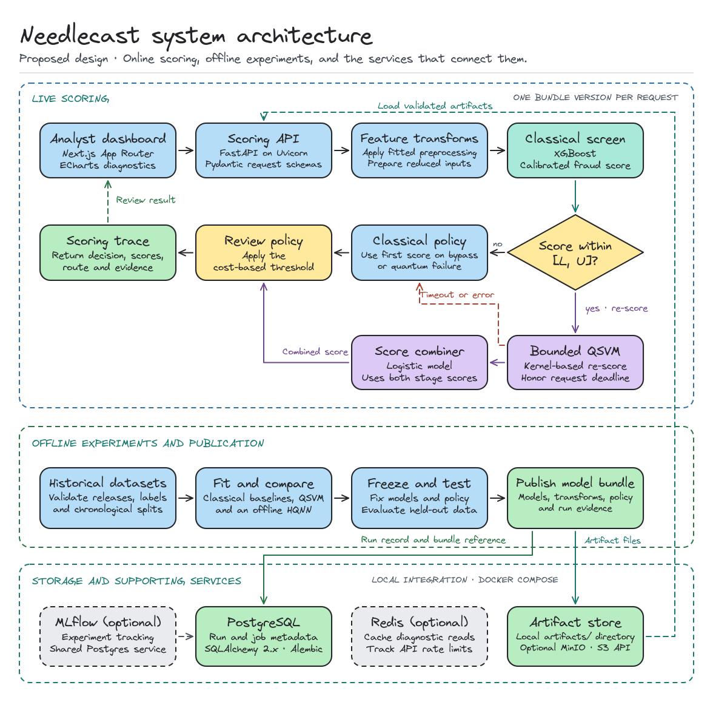
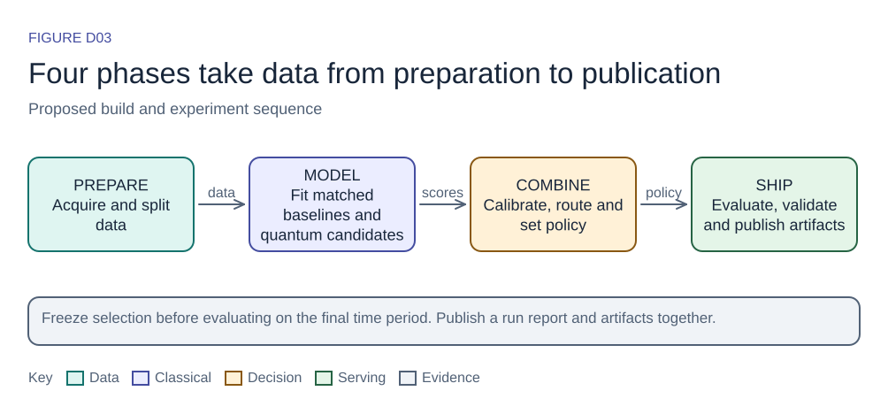
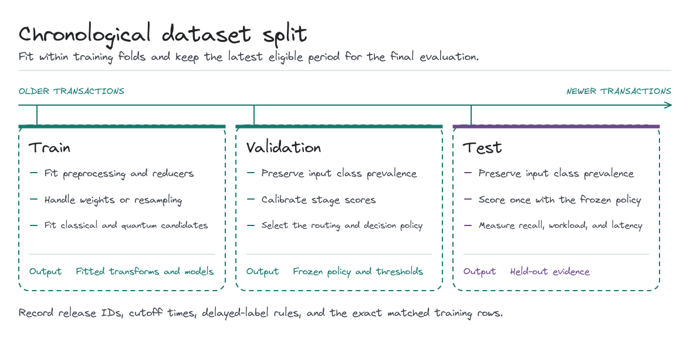
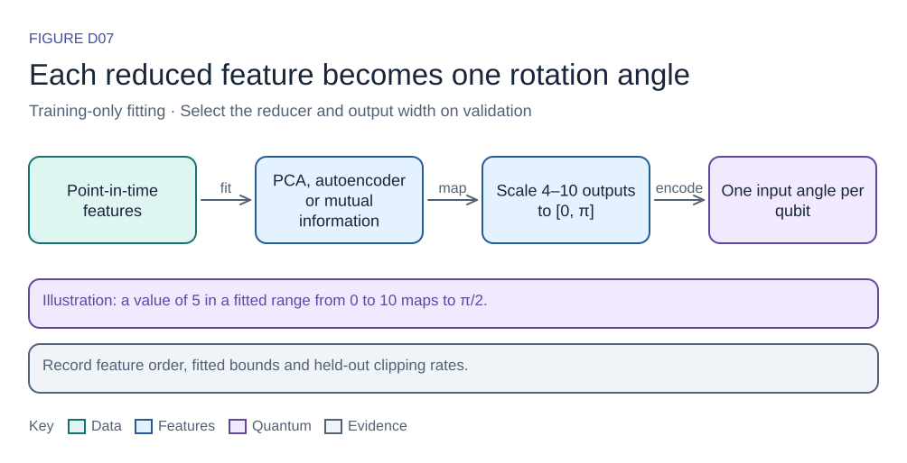
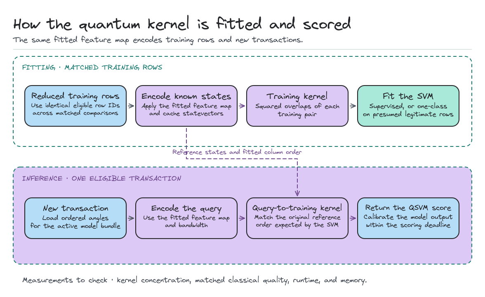
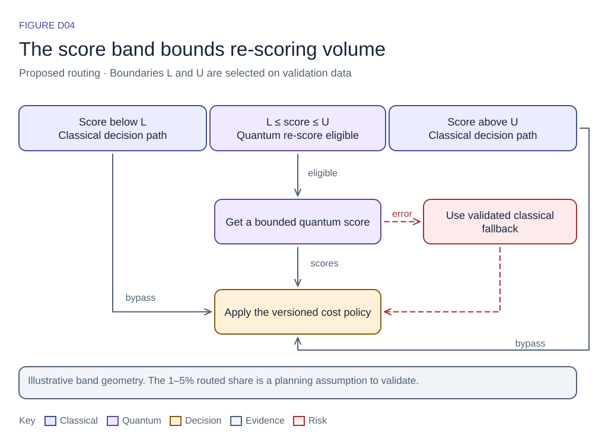
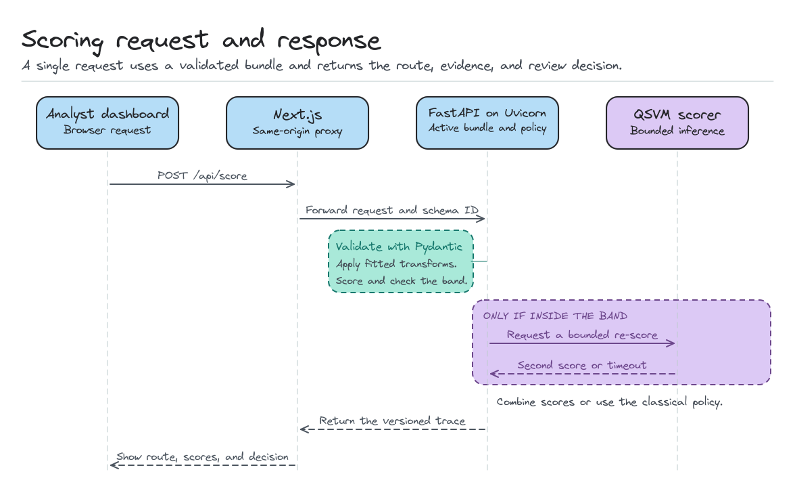

# Needlecast

**Hybrid quantum–classical credit card fraud detection**

Needlecast is a research project that tests whether a quantum model can improve fraud decisions on transactions a classical model finds difficult to classify. A classical model screens every transaction. A quantum support vector machine (QSVM) re-scores only the cases inside an uncertainty band. A cost-based policy then decides which transactions to flag for review.

**Project stage — Design and experiment planning.** The repository specifies the architecture, model comparisons, and serving contracts. The models, API, and dashboard are planned. Performance and cost are to be measured.

## Contents

- [Problem and scope](#problem-and-scope)
- [Proposed architecture](#proposed-architecture)
- [End-to-end workflow](#end-to-end-workflow)
- [Datasets and feature engineering](#datasets-and-feature-engineering)
- [Classical machine learning](#classical-machine-learning)
- [Quantum machine learning](#quantum-machine-learning)
- [Routing, cost and explainability](#routing-cost-and-explainability)
- [Evaluation plan](#evaluation-plan)
- [API and dashboard](#api-and-dashboard)
- [Technology stack](#technology-stack)
- [Development and deployment](#development-and-deployment)
- [Research references](#research-references)

## Problem and scope

Fraud is rare in the primary dataset. ULB Credit Card Fraud contains 492 fraudulent transactions out of 284,807, about 0.17%. A classifier that labels every transaction legitimate would achieve about **99.83% accuracy while catching zero frauds**. Needlecast therefore evaluates fraud recall, false alerts, and expected cost at specific operating points. [Dataset benchmark](https://github.com/amazon-science/fraud-dataset-benchmark)

The system is designed to surface cases for analyst review. Its central question is whether routing a small fraction of cases to a second model catches more fraud or reduces expected loss enough to justify the extra computation. Strong classical models provide the comparison. Automated payment declines and primary handling of card credentials are outside the project scope.

## Proposed architecture

*The classical screen handles the full stream, while only uncertain cases enter the quantum stage. Offline experiments separately publish versioned results and fitted models for serving.*

| Stage | Responsibility | Output |
| --- | --- | --- |
| Data intake | Validate event times, labels, and which features were available when each transaction occurred. | Dataset version and chronological splits |
| Preprocessing | Fit imputers, encoders, scalers, and candidate feature reducers on training data. | Versioned features and circuit angles |
| Classical screening | Produce the first calibrated fraud score and determine eligibility for re-scoring. | Classical score and routing decision |
| Quantum re-scoring | Use a fitted QSVM to score eligible cases within a time budget. Evaluate a hybrid quantum neural network separately. | Quantum score or a recorded reason it is unavailable |
| Decision | Combine available scores or use the validated classical policy. Apply a threshold and record how the decision was made. | Review decision and scoring trace |
| Serving | Load an approved model bundle and publish scores, metrics, and diagnostics to the dashboard. | Versioned API responses |

## End-to-end workflow

1. **Prepare.** Record dataset versions and checksums, audit for leakage, and reserve the most recent eligible period for testing.
2. **Model.** Fit classical baselines, then run the quantum comparisons using matched features and training samples.
3. **Combine.** Calibrate scores, select the uncertainty band, fit the score combiner on predictions from models that never saw the scored rows, and set the decision policy on validation data.
4. **Publish.** Evaluate the frozen pipeline on the held-out period. Package fitted transforms, model versions, thresholds, metrics, and circuit diagnostics together. Validate a complete bundle before activating it.

## Datasets and feature engineering

| Dataset or resource | Use in Needlecast |
| --- | --- |
| [ULB Credit Card Fraud](https://www.kaggle.com/datasets/mlg-ulb/creditcardfraud) | Primary quantum–classical benchmark. The 28 anonymized features have already undergone principal component analysis (PCA). Time and amount are separate inputs. [Dataset benchmark](https://github.com/amazon-science/fraud-dataset-benchmark) |
| [IEEE-CIS Fraud](https://www.kaggle.com/c/ieee-fraud-detection) | Feature reduction and generalization on richer transaction and identity data. The benchmark describes 590,540 labelled transactions with about 3.5% fraud. [Dataset benchmark](https://github.com/amazon-science/fraud-dataset-benchmark) |
| [PaySim](https://www.kaggle.com/datasets/ealaxi/paysim1) and [Sparkov](https://github.com/namebrandon/Sparkov_Data_Generation) | Synthetic data for classical-stage throughput and memory tests. Audit balance fields and generated features for information that reveals the outcome. |
| [Bank Account Fraud](https://github.com/feedzai/bank-account-fraud) | Future generalization study in a separate fraud domain. |
| [Amazon Fraud Dataset Benchmark](https://github.com/amazon-science/fraud-dataset-benchmark) | Reference loaders and dataset metadata. Needlecast defines and records its own evaluation splits. |

Features must be available at decision time. Exclude information derived from later chargebacks, investigation outcomes, or post-transaction balances. Fit preprocessing and any resampling inside training folds. Keep validation and test sets at their original fraud prevalence. Record data access terms and keep raw transactions and credentials outside version control.

Compare **PCA**, **mutual-information feature selection**, and an **autoencoder** on validation. The initial circuit design targets 4–10 ordered features. Scale each feature to a rotation angle in `[0, π]` using training bounds and record how often later inputs exceed those bounds.

## Classical machine learning

| Model | Why it is included |
| --- | --- |
| **XGBoost** | Primary full-stream scorer and a strong baseline in both matched and full-data runs. |
| **Logistic regression** | Interpretable baseline. A separately fitted logistic model combines stage scores in the proposed cascade. |
| **RBF-SVM and random Fourier features** | Matched comparisons for testing whether classical similarities explain the quantum kernel's behavior. |
| **Random forest and multilayer perceptron** | Tree and neural baselines that cover different modeling approaches. |
| **Isolation Forest** | Optional anomaly-scoring comparison when the availability or reliability of labels differs. |

Tune and calibrate models using chronological validation. Compare class weighting and training-only sampling. Report a full-data classical baseline separately from matched runs so the evaluation captures both scientific comparability and the best practical classical screen.

## Quantum machine learning

### Quantum support vector machine

The QSVM encodes each reduced feature vector into a quantum state using a **feature map**. A **fidelity kernel** measures similarity as the squared magnitude of the overlap between two encoded states. The resulting matrix is used by a support vector classifier. A one-class variant learns from presumed legitimate examples. [scikit-learn SVM guide](https://scikit-learn.org/stable/modules/svm.html)

The simulator-first plan compares **angle, ZZ-style, and IQP-style feature maps**. Encode each training example once where possible, cache compatible states, and compute overlaps in batches. Tune feature-map bandwidth on validation to test whether scaling the angles improves useful similarity differences. At inference, compute similarities using the fitted model's required training references or support vectors.

An exact kernel matrix for $n$ training examples has $n^2$ entries, and adding a qubit doubles the size of a dense statevector. The initial experiments therefore use small circuits and matched subsets, with separate measurements of runtime and peak memory before increasing either size.

### Hybrid quantum neural network

The **HQNN** is an offline comparison model. It passes features through a classical encoder, a trainable quantum circuit, and a classical classifier head. The initial search uses 4–8 qubits and 2–3 circuit layers. Test class-weighted loss and optional data re-uploading, which reintroduces the inputs at multiple circuit layers. Compare with a classical multilayer perceptron on the same samples. [PennyLane TorchLayer](https://docs.pennylane.ai/en/stable/code/api/pennylane.qnn.TorchLayer.html)

### Quantum diagnostics

| What can go wrong | What to measure |
| --- | --- |
| **Kernel concentration** | Inspect similarity matrices, off-diagonal variance, and alignment between similarity and fraud labels. Compare with tuned classical kernels. |
| **Weak training gradients** | Measure HQNN gradient variance across initializations, circuit widths, and depths. |
| **Noise and finite measurements** | Compare ideal simulation with noisy and finite-shot runs. Record score variation, circuit depth, and two-qubit gate counts. |
| **Compute overhead** | Measure kernel construction time, peak memory, and end-to-end re-scoring time. An optional small hardware experiment can show how device and queue conditions affect the results. |

## Routing, cost and explainability

A calibrated classical score inside the validation-selected interval enters the quantum stage. For an illustrative band of `[0.40, 0.60]`, a score of `0.48` is eligible and a score of `0.85` bypasses re-scoring. Those values explain the rule. The operating band, threshold, and share routed will be measured during validation.

If the quantum model returns a score on time, a calibrated logistic combiner uses both stages. A timeout or unavailable second score triggers a separately validated classical fallback. The decision threshold minimizes validation cost subject to review capacity. The planned cost model uses estimated transaction exposure for each missed fraud and review cost plus customer friction for each false alert. Report aggregate and per-transaction cost in INR, with documented conversion and sensitivity to the assumptions.

The scoring trace records the model versions, scores, route, threshold, decision, and any fallback reason. The proposed analyst interface uses **SHAP** contributions for compatible classical models and similarities to authorized, de-identified support examples when the QSVM provides a score. These provide evidence for human review. [SHAP documentation](https://shap.readthedocs.io/en/latest/)

## Evaluation plan

1. **Run matched comparisons.** Use the same features, training rows, chronological splits, and evaluation rows across quantum and classical alternatives. The initial matched training budget is 1,000–3,000 examples where feasible. Record the number of fraud cases and repeat across at least five seeds.
2. **Test the whole pipeline.** Compare the cascade against the full-data classical screen. Run ablations that remove quantum re-scoring and vary the band, feature reducer, or circuit settings.
3. **Report uncertainty and limitations.** Publish per-seed results, summary statistics, and paired time-block intervals where the data supports them. Run drift checks on later windows. Report regressions, ties, and inconclusive comparisons.

| Measure | Question answered |
| --- | --- |
| **Precision–recall performance** | How well does the model rank fraud when positives are rare? Report average precision and the precision–recall curve. |
| **Recall at a fixed false-positive rate** | How much fraud can the detector catch under a comparable false-alert budget? |
| **F1 and Matthews correlation coefficient** | How do thresholded classification results compare at the chosen operating point? |
| **Expected cost and workload** | How much estimated loss and review effort does each policy produce? |
| **Latency, memory, and routing** | What does the second stage cost operationally, how much traffic reaches it, and how often does fallback occur? |

The evaluation will report the tradeoff between fraud recall and the share of traffic sent for re-scoring. Model accuracy, speed, and financial benefit remain to be measured.

## API and dashboard

The planned FastAPI service loads a validated bundle and runs bounded inference. Training and experiment jobs run separately. An artifact bundle includes the dataset and split IDs, transform and model versions, configuration, seeds, code revision, checksums, metrics, and circuit diagnostics. A failed publication leaves the previous validated bundle available.

| Planned interface | Purpose |
| --- | --- |
| `POST /api/score` | Validate the input feature schema and return the stage-by-stage trace. |
| `GET /api/datasets` and `GET /api/pipeline/reduction` | Show dataset provenance, split statistics, and feature-reduction settings. |
| `GET /api/models/*` and `GET /api/diagnostics/*` | Serve comparisons, ablations, circuits, kernel heatmaps, gradients, and noise measurements. |
| `POST /api/jobs/run` and `GET /api/jobs/{id}` | Queue an authorized offline experiment and retrieve its status. |

The Next.js dashboard is planned to show dataset provenance, feature reduction, model comparisons, diagnostics, and individual scoring traces. Clearly label demonstration fixtures and restrict customer data, scores, and explanations to authorized users.

## Technology stack

The stack below describes the target implementation. Exact dependency versions and compatibility will be verified when the implementation is in place.

| Layer | Tools and official documentation |
| --- | --- |
| Data and classical ML | [Python 3.11](https://docs.python.org/3.11/), [scikit-learn](https://scikit-learn.org/stable/), [XGBoost](https://xgboost.readthedocs.io/en/stable/), [imbalanced-learn](https://imbalanced-learn.org/stable/), and [PyTorch](https://github.com/pytorch/pytorch) |
| Quantum models and simulation | [PennyLane](https://pennylane.ai/) and [Lightning](https://docs.pennylane.ai/projects/lightning/en/stable/), [Qiskit](https://quantum.cloud.ibm.com/docs/en/guides), [Qiskit Machine Learning](https://github.com/qiskit-community/qiskit-machine-learning), and [Qiskit Aer](https://qiskit.github.io/qiskit-aer/) |
| Explanations and experiments | [SHAP](https://shap.readthedocs.io/en/latest/) and optional [MLflow](https://mlflow.org/) |
| API and schemas | [FastAPI](https://fastapi.tiangolo.com/) and [Pydantic](https://docs.pydantic.dev/latest/) |
| Web application | [Node.js](https://nodejs.org/en/about/previous-releases), [Next.js App Router](https://nextjs.org/docs/app), [TypeScript](https://www.typescriptlang.org/docs/), [Tailwind CSS](https://tailwindcss.com/docs), [shadcn/ui](https://ui.shadcn.com/), and [Apache ECharts](https://echarts.apache.org/) |
| Integration and deployment | [openapi-typescript](https://openapi-ts.dev/) for client types, [Next.js rewrites](https://nextjs.org/docs/app/api-reference/config/next-config-js/rewrites) for API proxying, and [Docker Compose](https://docs.docker.com/compose/) for local integration |
| Optional hardware | [IBM Quantum](https://quantum.cloud.ibm.com/) for a small, separately measured hardware experiment |

## Development and deployment

| Milestone | Completion criterion |
| --- | --- |
| **Design** · current | Document the scoring pipeline, models, evaluation, and service interfaces. |
| **Offline prototype** · planned | Reproduce dataset splits, train baselines, run matched quantum comparisons, and publish versioned results. |
| **Scoring service and dashboard** · planned | Serve a validated bundle, display scoring traces, and exercise timeouts and fallback. |
| **Shadow evaluation** · planned | Measure drift, latency, review volume, and cost with no effect on customer-facing decisions. |
| **Controlled deployment** · planned | Verify access controls, audit records, operational limits, and rollback before broader use. |

For implementation details, see [system design](docs/system-design.md), [data and models](docs/data-and-models.md), [evaluation protocol](docs/experiment-protocol.md), and [serving and deployment](docs/serving-and-deployment.md).

## Research references

| Source | What it informs |
| --- | --- |
| [Mixed quantum–classical fraud detection with quantum feature selection](https://arxiv.org/abs/2208.07963) | Earlier use of a hybrid approach for fraud detection. |
| [Unsupervised quantum machine learning for fraud detection](https://arxiv.org/abs/2208.01203) | Motivation for the one-class comparison. |
| [FD4QC technical report](https://arxiv.org/abs/2507.19402) | Prior empirical comparisons of classical and hybrid financial fraud models. |
| [Applications of quantum machine learning for quantitative finance](https://arxiv.org/abs/2405.10119) | Broader financial use cases and evaluation context. |
| [Exponential concentration in quantum kernel methods](https://arxiv.org/abs/2208.11060) | Why a kernel can lose useful differences between encoded samples. |
| [Similarity of bandwidth-tuned quantum and classical kernels](https://arxiv.org/abs/2503.05602) | Why a tuned classical kernel is an essential comparison. |
| [Barren plateaus in quantum neural network training landscapes](https://arxiv.org/abs/1803.11173) | Why the HQNN evaluation includes gradient diagnostics. |
| [Fraud Dataset Benchmark and Applications](https://arxiv.org/abs/2208.14417) | Dataset provenance and fraud benchmark methodology. |
| [Turning the Tables: Biased, Imbalanced, Dynamic Tabular Datasets for ML Evaluation](https://arxiv.org/abs/2211.13358) | Background on the Bank Account Fraud datasets for future robustness testing. |
