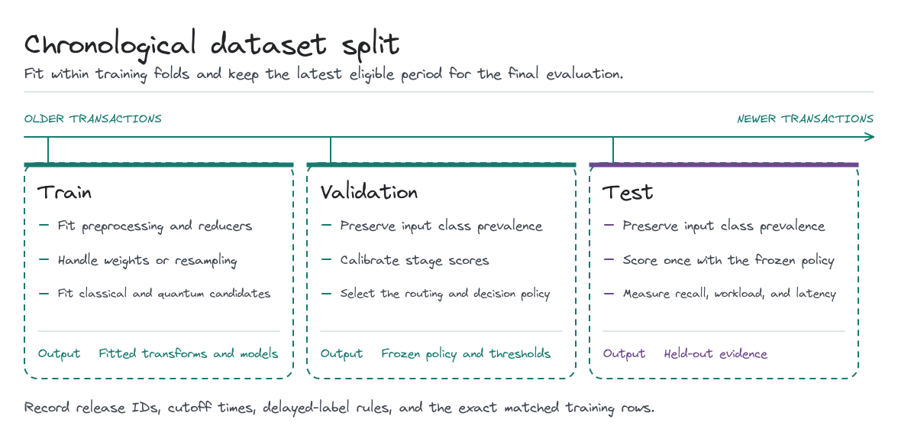
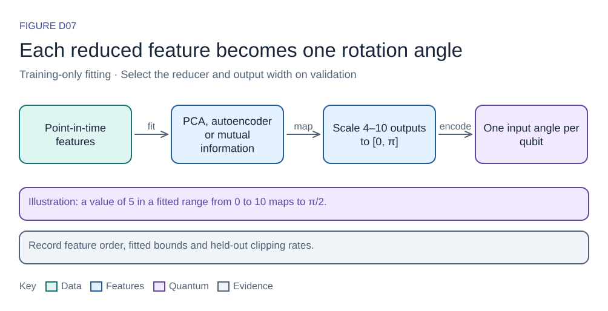

# Data and models

This guide defines the inputs and model fitting procedure for the planned experiments. The [README dataset table](../README.md#datasets-and-feature-engineering) lists the provider links and each dataset's role.

## Prepare the data

1. Confirm release and access terms, then record the source URL, release ID, checksum, label definition, timestamp semantics, row counts, and fraud prevalence.
2. Inspect duplicate keys, missing values, join cardinality, and label delays. For IEEE-CIS, validate the transaction-to-identity join and record how unmatched rows are handled. For synthetic scale data, review balance and outcome fields for leakage.
3. Build chronological training, validation, and test windows. Reserve the latest eligible window for test. Record cutoffs, timestamp units, ties, and any gap for label maturity. Preserve the original prevalence in validation and test.
4. Build features from information available at scoring time. Fit imputers, encoders, scalers, reducers, and any resampling on training rows only. Record feature names and order, missing-value policy, and out-of-range handling.

Verify the release and permitted use before downloading. Record the exact generated or downloaded snapshot for synthetic data. Keep row-level data and download credentials outside Git. Apply weights or any oversampling within each training fold, and report original and sampled counts.

## Fit preprocessing and classical models

Compare PCA on scaled inputs, mutual-information selection using training labels, and an autoencoder fitted on training data. Select the reducer and width on validation. The initial quantum experiments use 4–10 ordered output features. For each feature, fit its minimum and maximum on training data, scale to an angle in `[0, π]`, and clip out-of-range values. Map constant features to zero and log the clipping rate by feature.

Train XGBoost as the full-stream screen. Compare a matched XGBoost run, logistic regression, RBF-SVM, random Fourier features, random forest, and a multilayer perceptron. Isolation Forest is an optional anomaly-scoring comparison. Use chronological validation for hyperparameters and score calibration. Record the search budget, class weights or sampling policy, and score orientation.

## Fit the quantum comparisons

### Quantum support vector machine

1. Compare angle, ZZ-style, and IQP-style feature maps. Record circuit width, repetitions, entanglement pattern, and the bandwidth applied to input angles.
2. Encode the fitted training rows as statevectors. Compute the squared magnitude of pairwise overlaps in batches. Cache states by row or feature hash, transform version, circuit settings, simulator, and precision.
3. Check the exact training kernel for shape, finite values, symmetry, and a near-unit diagonal. Keep the fitted column order for query-to-training inference. Verify prediction parity before considering a support-vector-only scorer.
4. Fit a supervised SVM with the precomputed kernel. Evaluate a one-class comparison on presumed legitimate rows and record possible contamination. Tune and calibrate each candidate on validation.

### Hybrid quantum neural network

Start with a classical encoder, a trainable circuit with 4–8 qubits and 2–3 layers, and a classical classifier head. Compare optional data re-uploading and class-weighted loss. Record initialization, optimization and stopping rules, runtime, and gradient variance. Compare against a classical multilayer perceptron on matched samples.

See the [evaluation protocol](experiment-protocol.md) for splits, circuit diagnostics, and reporting. The [technology stack](../README.md#technology-stack) links to the planned libraries.
