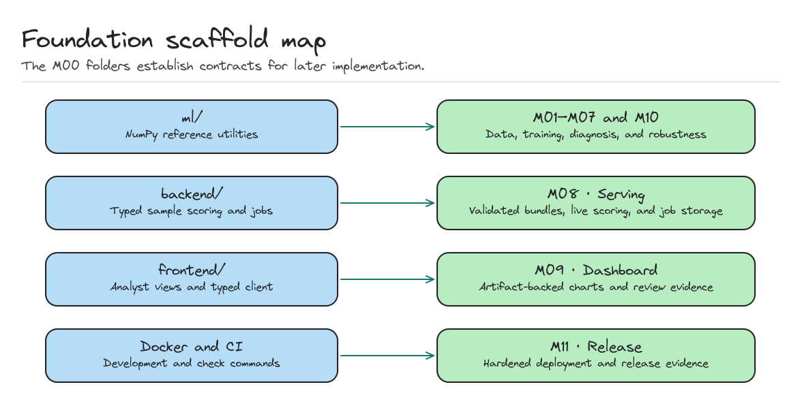

# M00 · Foundation and scaffold

**Status** · Scaffolded (stub)

## Objective

Run the placeholder app end to end.

## Why it matters

Give each contributor a typed reference for how artifacts, API responses, and dashboard views fit together.

## Prerequisites and dependencies

A clean checkout and supported Python and Node runtimes.

## Detailed task checklist

1. **S** · `Makefile and .env.example` · Define setup, fixture generation, local startup, and configuration.
2. **M** · `ml/src/needlecast_ml and ml/artifacts` · Implement the small reference utilities and generate versioned JSON samples.
3. **M** · `backend/app and frontend/src` · Serve and display sample artifacts, scores, and diagnostic results.
4. **M** · `.github/workflows and docker-compose.yml` · Wire CI, container health checks, and reproducible local packaging.

The foundation establishes shared interfaces and gives each area an owning milestone.

## Deliverables

- Generated JSON and circuit fixtures.
- Typed FastAPI routes, dashboard structure, development tooling, and Docker definitions.

## Acceptance criteria

- Every sample API response identifies placeholder mode.
- Regeneration with the same seed produces identical artifact bytes.
- At least one in-band and one bypass score show the expected trace.

## Test plan

Run the M00 gates and record environment-specific checks. Use TestClient for missing files, scoring routes, and idempotent job retries.

## Risks and mitigations

Synthetic numbers can be mistaken for measurements. Keep the data label in HTTP responses, on every page, and in the fixture policy.

## Exit checklist

- [ ] Validate schemas and generated contracts.
- [ ] Exercise both routing outcomes.
- [ ] Record skipped runtime checks and their blockers.

## Related docs

- [Design reference](../system-design.md)
- [Quality gates](quality-gates.md)
- [Dependency map](dependency-map.md)
