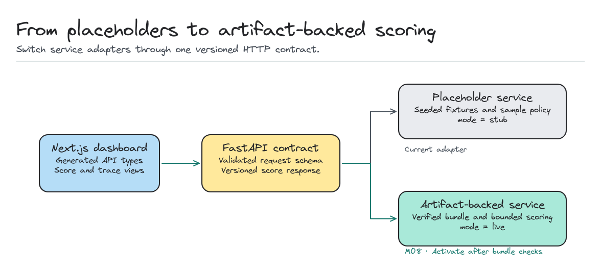

# M08 · Serving

**Status** · Planned

## Objective

Serve validated versioned runs.

## Why it matters

A dashboard observation needs a single traceable model bundle and a stable bound on response time.

## Prerequisites and dependencies

[M07](M07-cascade-and-cost.md)

## Detailed task checklist

1. **M** · `backend/app/services/artifact_store.py` · Load and atomically activate checksummed bundles. Add PostgreSQL run and job metadata via SQLAlchemy and Alembic.
2. **M** · `backend/app/services/scoring_service.py` · Add artifact-backed scoring with a hard deadline, classical fallback, and score evidence.
3. **M** · `backend/app/services/job_service.py` · Authorize preset jobs and persist idempotency keys outside request training paths.

Add the live adapter behind the same response contract and switch the active bundle only after validation.

## Deliverables

- Artifact-backed scorer, database migrations and job adapter.
- Versioned OpenAPI and rollback evidence.

## Acceptance criteria

- Invalid candidate bundles leave prior versions active.
- Each request resolves one bundle ID.
- Timeouts return a typed classical fallback with a reason.

## Test plan

Inject missing assets and deadlines, test authorization and idempotency, and run generated-client contract tests.

## Risks and mitigations

A partial release can mix incompatible transforms and models. Validate everything before switching the active bundle.

## Exit checklist

- [ ] Verify allowed run lookups.
- [ ] Rehearse rollback.
- [ ] Measure service deadlines.

## Related docs

- [Design reference](../serving-and-deployment.md)
- [Quality gates](quality-gates.md)
- [Dependency map](dependency-map.md)
