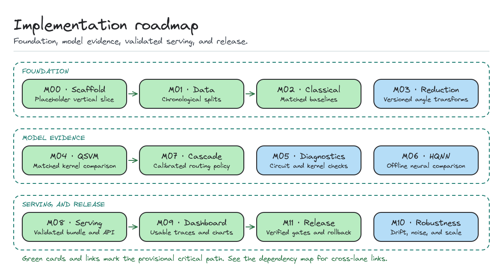

# Implementation roadmap

M00 establishes the placeholder application. Later milestones use the same contracts to reproduce experiments and publish validated results. Start with the active milestone, check its prerequisites, and attach evidence against the exit checklist.

| Size | Estimate for one engineer |
| --- | --- |
| S | Under one day |
| M | One to three days |
| L | Three to seven days |

These are planning estimates. Release readiness depends on the recorded evidence.

## Definition of done

- Link the milestone and record the revision and changed contracts.
- Run the relevant checks and attach outputs with exact commands.
- Record data or artifact IDs, schema versions, configuration and seeds where applicable.
- Update docs and diagrams, validate links, and record any outstanding gates.
- Confirm a reviewer can reproduce the checks from a clean checkout.

## Milestones

Solid green connectors mark the planning path from the scaffold through validated scoring and release.

| ID | Milestone | Outcome | Dependencies | Size | Status |
| --- | --- | --- | --- | --- | --- |
| [M00](M00-foundation.md) | Foundation and scaffold | Run the placeholder app end to end | — | L | Scaffolded (stub) |
| [M01](M01-data-layer.md) | Data layer | Produce leakage-checked chronological splits | M00 | M | Planned |
| [M02](M02-classical-baselines.md) | Classical baselines and metrics | Publish matched classical baselines | M01 | L | Planned |
| [M03](M03-feature-reduction.md) | Feature reduction | Freeze an ordered, versioned angle transform | M01 | M | Planned |
| [M04](M04-qsvm-core.md) | QSVM core | Train matched and one-class kernel comparisons | M02, M03 | L | Planned |
| [M05](M05-quantum-diagnostics.md) | Quantum diagnostics | Measure kernel and circuit behavior | M04 | M | Planned |
| [M06](M06-hqnn.md) | Hybrid quantum neural network | Run a matched HQNN comparison | M02, M03 | L | Planned |
| [M07](M07-cascade-and-cost.md) | Cascade, ensemble, and cost | Freeze a calibrated routed policy | M02, M04 | L | Planned |
| [M08](M08-serving.md) | Serving | Serve validated versioned runs | M07 | L | Planned |
| [M09](M09-dashboard-completion.md) | Dashboard completion | Make artifacts and traces usable for analysts | M00, M08 | L | Planned |
| [M10](M10-robustness-and-scale.md) | Robustness and scale | Stress-test drift, noise and scale | M05, M06, M07 | L | Planned |
| [M11](M11-hardening-and-release.md) | Hardening and release | Prepare a reproducible controlled release | M08, M09, M10 | L | Planned |

See the [dependency map](dependency-map.md), [backlog](backlog.md), and [quality gates](quality-gates.md).
