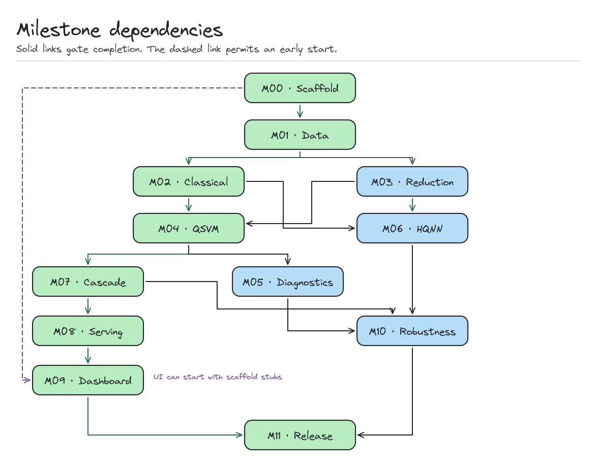

# Milestone dependency map

After the data layer, the ML branches can progress in parallel while the dashboard begins against sample APIs.

## Dependencies

| Milestone | Must follow |
| --- | --- |
| [M00](M00-foundation.md) | Start here |
| [M01](M01-data-layer.md) | [M00](M00-foundation.md) |
| [M02](M02-classical-baselines.md) | [M01](M01-data-layer.md) |
| [M03](M03-feature-reduction.md) | [M01](M01-data-layer.md) |
| [M04](M04-qsvm-core.md) | [M02](M02-classical-baselines.md), [M03](M03-feature-reduction.md) |
| [M05](M05-quantum-diagnostics.md) | [M04](M04-qsvm-core.md) |
| [M06](M06-hqnn.md) | [M02](M02-classical-baselines.md), [M03](M03-feature-reduction.md) |
| [M07](M07-cascade-and-cost.md) | [M02](M02-classical-baselines.md), [M04](M04-qsvm-core.md) |
| [M08](M08-serving.md) | [M07](M07-cascade-and-cost.md) |
| [M09](M09-dashboard-completion.md) | [M00](M00-foundation.md), [M08](M08-serving.md) |
| [M10](M10-robustness-and-scale.md) | [M05](M05-quantum-diagnostics.md), [M06](M06-hqnn.md), [M07](M07-cascade-and-cost.md) |
| [M11](M11-hardening-and-release.md) | [M08](M08-serving.md), [M09](M09-dashboard-completion.md), [M10](M10-robustness-and-scale.md) |

## Critical path

Use M00 → M01 → M02 → M04 → M07 → M08 → M09 → M11 as the provisional planning path. Recalculate it as estimates change. M03 must be finished by M04. M05 and M06 join M07 at M10, which also gates release.

## Parallel work

- Start M02 and M03 once M01 publishes approved data and splits.
- Start M05 after M04. M06 can proceed from M02 and M03 without waiting for QSVM diagnostics.
- Begin M09 pages against M00 stubs while model work proceeds. Complete live-artifact integration after M08.
- Prepare the M11 release checklist while M09 and M10 run. Tag the release after both produce evidence.
