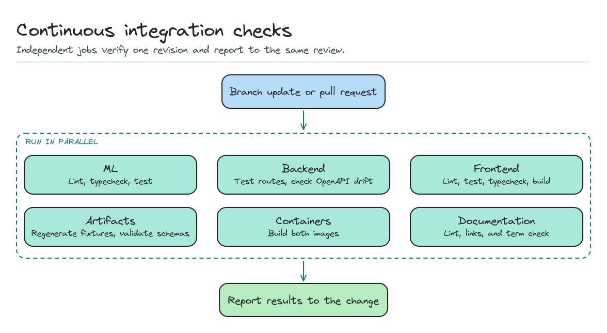
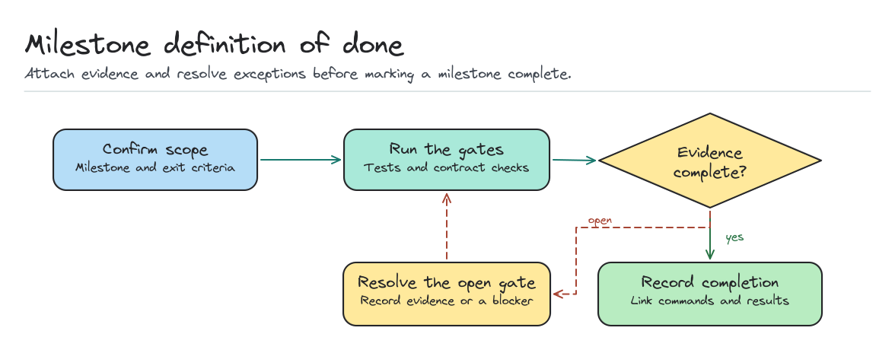

# Quality gates

Independent jobs provide evidence for a single revision before the change can be merged.

A failed or unavailable gate stays open with its reason and a reproducible next check.

## Baseline gates

Run lint, tests and type checks for changed code. Validate updated artifact schemas, contracts, local links, and diagram embeds. Attach the output to the milestone record and report any unavailable check.

| Milestone | Additional checks |
| --- | --- |
| M00 | Generate and validate fixtures, export OpenAPI/types without drift, check scores and jobs, load every dashboard route, build and start Compose. |
| M01 | Match counts to the dataset card, validate cutoff metadata, and reject leakage and missing classes. |
| M02 | Verify average precision and threshold metrics with fixtures and reproduce per-seed evidence. |
| M03 | Verify reducer serialization, train-only fitting, constant-feature handling, and clipped angle bounds. |
| M04 | Check kernel invariants, reference-order parity, cache identity, and optional dependency isolation. |
| M05 | Validate heatmap order, alignment reference examples, circuit metadata, and SVG references. |
| M06 | Verify gradient propagation, matched settings, and recorded layer-level variance. |
| M07 | Verify band edges, cost ties, review caps, and the bypass/fallback routes. |
| M08 | Verify versioned startup, safe errors, idempotency, artifact containment, deadline behavior, and rollback. |
| M09 | Run browser and keyboard checks for every page and review loading, empty, and failure states. |
| M10 | Confirm paired noise, drift windows, and reproducible scale measurements. |
| M11 | Run all applicable gates from a clean checkout and verify signed-off deployment evidence. |

## Release checklist

- [ ] Record the commit, dependencies, image digests, and artifact manifest checksums.
- [ ] Confirm documentation, diagrams, generated types, and a clean schema drift check.
- [ ] Build and start the full stack, then verify health and browser smoke checks.
- [ ] Validate retention, access controls, sensitive-data handling, and rollback.
- [ ] Publish the benchmark evidence and release notes, including unresolved limitations.
- [ ] Confirm the maintainer-selected license and tag the verified revision.
