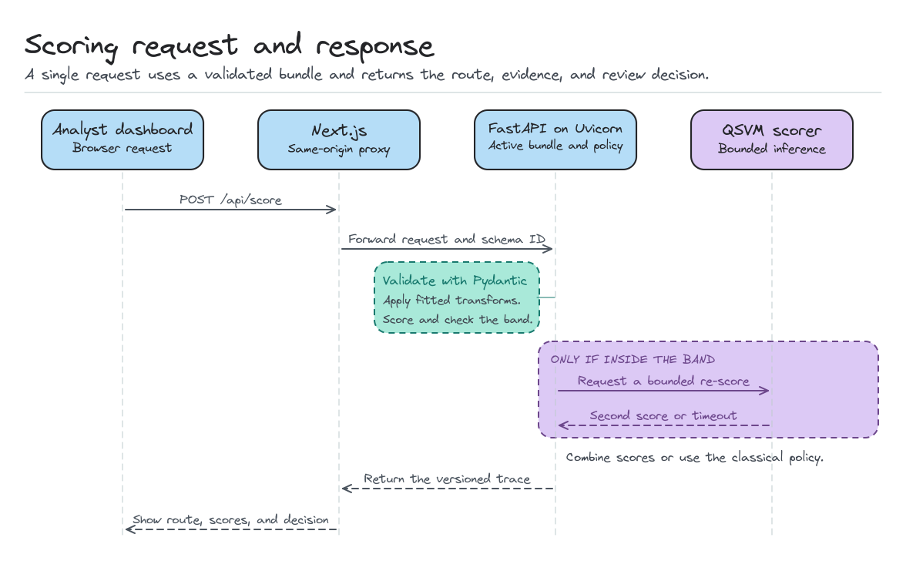

# Serving and deployment

This is the planned interface for FastAPI, the background worker, and the Next.js dashboard. The service loads a validated model bundle for bounded inference. Experiment jobs run outside request handlers.



## API routes

| Method and path | Response or action |
| --- | --- |
| `GET /api/datasets` | Dataset provenance, split windows, counts, and label prevalence |
| `GET /api/pipeline/reduction` | Feature schema, reducer version, dimensions, and scaling summaries |
| `GET /api/models/comparison` | Metrics, precision–recall and ROC curves, and evaluation provenance |
| `GET /api/models/ablations` | Matched changes, metric deltas, routing load, and interval methods |
| `GET /api/diagnostics/circuits` | Circuit references, depth, and gate counts |
| `GET /api/diagnostics/kernel` | Sampled similarity matrix, variance, and alignment |
| `GET /api/diagnostics/hqnn` | Loss summaries and layer-level gradient variance |
| `GET /api/diagnostics/noise` | Noise and shot settings with paired measurements |
| `POST /api/score` | Versioned stage trace and review decision |
| `POST /api/jobs/run` | Queue an approved experiment preset for an authorized caller |
| `GET /api/jobs/{id}` | Return the job state and the published run ID when available |

Artifact responses include `schema_version`, `run_id`, `created_at`, `dataset_id`, `split_id`, and `data`. Select the active bundle by default and support an authorized `run_id` lookup for published runs. Return only validated artifact references.

## Scoring contract

A request includes `feature_schema_id`, a `transaction` object containing the approved feature values, and `mode`. Validate required inputs, finite values, and the requested mode. A score trace records the request ID, bundle and policy IDs, classical model and score, optional QSVM result, final score, threshold, decision, route, and explanation evidence.

This illustrative response shows a timed-out re-score for a synthetic record.

```json
{
  "schema_version": "1",
  "request_id": "example-01",
  "mode": "fixture",
  "bundle_id": "sample-bundle",
  "policy_id": "sample-policy",
  "classical": {"model_id": "sample-classical", "score": 0.48, "elapsed_ms": null},
  "route": "classical_fallback",
  "quantum": null,
  "final_score": 0.48,
  "threshold": 0.60,
  "decision": "clear",
  "fallback_reason": "quantum_timeout",
  "evidence": {"classical": [], "quantum": []}
}
```

Use `classical_only` for a bypass, `quantum_rescored` for a completed second score, and `classical_fallback` for an eligible request whose second score failed. Use a null quantum result for bypass and fallback. Return a fallback reason for failed re-scoring. Planned decisions are `clear` and `review`.

Validate and authorize job presets and dataset versions. Use an idempotency key for retries and return HTTP 202 with the job ID and status URL. Provide a safe error code when a job fails. For API failures, return a stable error code, safe message, and request ID. Use HTTP 422 for input validation failures and 503 when required scoring assets are unavailable. Keep raw features and customer identifiers out of default logs.

## Dashboard

Proxy browser requests to the internal API through Next.js and generate client types from OpenAPI. Show model comparison, dataset provenance, circuit diagnostics, and scoring traces. Surface route, threshold, score availability, and fallback status. Distinguish fixture and recorded examples from live scores. For review evidence, show SHAP contributions and authorized, de-identified support examples when available.

## Deployment checks

1. **Local integration.** Run the dashboard, API, and worker as separate services. Mount published artifacts read-only for serving. Test schema validation, bundle activation, rollback, duplicate job submissions, and fallback using fixtures.
2. **Shadow evaluation.** Score an approved stream without changing existing customer decisions. Measure drift, latency, fallback rate, and review volume before setting rollout limits.
3. **Controlled pilot.** Verify authorization, audit records, retention, resource limits, and rollback. Enable bounded quantum re-scoring only after the classical path and fallback are validated.

See [system design](system-design.md) for bundle publication and [evaluation](experiment-protocol.md) for decision and rollout evidence.
