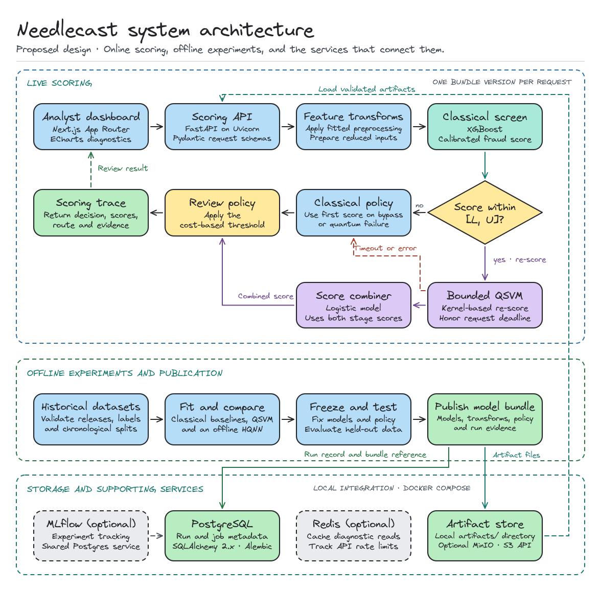

# System design

The M00 scaffold demonstrates this design with placeholders. The paths below describe validated serving. The architecture separates the offline experiment pipeline from the scoring service. The experiment pipeline fits and evaluates models. The service loads a validated run and scores incoming transactions.

## Scoring responsibilities

| Component | Inputs | Output |
| --- | --- | --- |
| Feature pipeline | Transaction values and the published feature schema | Validated values in the fitted model's expected order, with reduced angles for the quantum path |
| Classical screen | Classical model inputs and fitted calibration | First fraud score for every eligible transaction |
| Router | First score and the active policy's inclusive bounds | Classical-only path or eligibility for the quantum re-score |
| Quantum scorer | Reduced angles, fitted feature map, and model references | Calibrated QSVM score or an unavailable result |
| Decision policy | Available model scores and the active policy | Final score, review decision, and trace |
| Serving layer | Active bundle and authorized requests | Scoring results and experiment artifacts for the dashboard |

Apply the logistic combiner when the QSVM returns an eligible score within its deadline. Outside the uncertainty band, use the validated classical policy. A timeout or scoring failure inside the band uses the classical fallback and records the reason. If required classical assets are unavailable, return a service error. The HQNN remains an offline comparison model.

## Publishing a run

1. Write outputs to a staging location. Record the schema version, run ID, dataset and split IDs, feature schema, model and policy IDs, seeds, dependency versions, source revision, and creation time in UTC.
2. Validate the fitted transforms, calibration and thresholds as one compatible bundle. Check file hashes, expected schemas, mandatory artifacts, and path containment under the artifact root.
3. Activate the complete bundle atomically. Keep the previous validated bundle available for rollback. Serving uses a single bundle version throughout each request.

Published outputs can include fitted models, comparisons and ablations, precision–recall curves, circuit statistics, and sampled kernel diagnostics. Expose only the artifact fields needed by the API and dashboard. Keep raw transactions, credentials, and customer identifiers out of published bundles.

See [data and models](data-and-models.md) for inputs, [evaluation](experiment-protocol.md) for policy selection, and [serving](serving-and-deployment.md) for the HTTP contract.
